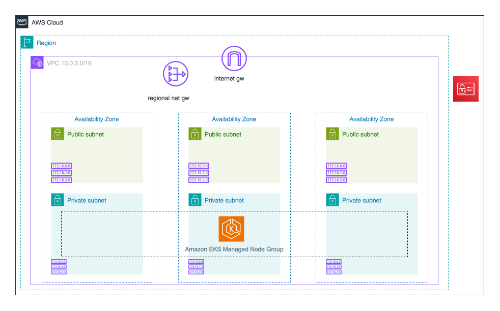
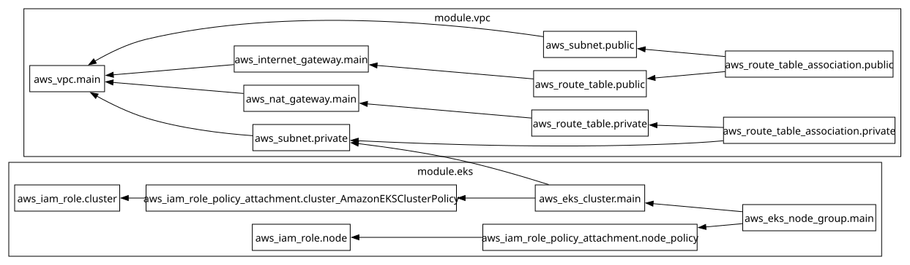

# E-Commerce DevOps Project — AWS Infrastructure (Terraform)

This repository contains **Terraform code** to provision **AWS infrastructure** for the e-commerce-devops-project.

---

### Other Related Repositories

- Source code repository for this project - [e-commerce-devops-project-src](https://github.com/tharix46/e-commerce-devops-project-src)
- Kubernetes repository for this project - [e-commerce-devops-project-k8s](https://github.com/tharix46/e-commerce-devops-project-k8s)

---

### Architecture



---

### Repository Structure

```
├── .terraform/
├── .terraform-version
├── .terraform.lock.hcl
├── backend.hcl
├── terraform.tfvars
├── local.tf
├── main.tf
├── modules
│   ├── eks
│   │   ├── main.tf
│   │   ├── outputs.tf
│   │   └── variables.tf
│   └── vpc
│       ├── main.tf
│       ├── outputs.tf
│       └── variables.tf
├── outputs.tf
├── provider.tf
├── README.md
├── terraform.tf
└── variables.tf
```

---

### What This Repository Does

This project provisions the following AWS resources:

- VPC
  - public subnets
  - private subnets
  - internet gateway
  - regional NAT gateway
  - route tables
- Amazon EKS cluster
  - managed node groups running in the private subnets
  - IAM roles and AWS-managed policy attachments for the EKS control plane
  - IAM roles and AWS-managed policy attachments for EKS worker nodes.

---

### Terraform Commands Used

```bash
tf init -backend-config="backend.hcl"

tf fmt

tf validate

tf plan

tf apply -auto-approve

terraform state list

tf graph | dot -Tsvg > graph.svg

tf output

tf providers lock --platform=linux_amd64

tf destroy -auto-approve
```

---

### Dependency Graph



---
